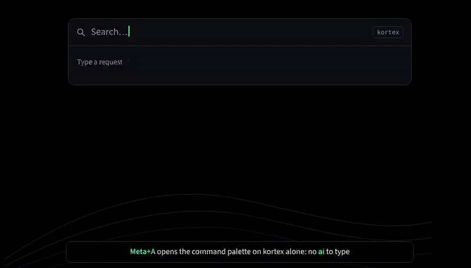

<h1 align="center">
  <picture>
    <source media="(prefers-color-scheme: dark)" srcset="docs/logo.svg">
    
  </picture>
</h1>

<p align="center">
  <a href="https://github.com/patina-os/kortex/actions/workflows/ci.yml"></a>
  <a href="LICENSE"></a>
  <a href="https://github.com/patina-os/patina"></a>
</p>

<p align="center">
  The AI agent in KDE Plasma's command palette. Ask in a few words, watch it work
  where you asked, and allow each change before it happens.
</p>



<sub>A replay of a real run of kortex 0.4.1 with opencode 1.19.5 and a scripted model
that thinks before it answers: kortex answered over D-Bus what you see, the panel is
drawn for the replay. How it is made: [`docs/demo/`](docs/demo/).</sub>

kortex is a small part of [patina](https://github.com/patina-os/patina), the polish
layer for Plasma on Debian: patina installs it with its AI agent and puts it on Meta+A.
It works on any Plasma 6 desktop that has [opencode](https://opencode.ai) or
[Hermes Agent](https://github.com/NousResearch/hermes-agent): they are the agent, kortex
is where you talk to it.

## What it does

- **Ask from anywhere.** Meta+A opens the palette on the agent alone. Any search in
  Meta+Space or the start menu ends with "Ask opencode: …", first when it reads as a
  question. `ai` and a request asks at once, as before.
- **Watch it work.** The answer grows in the palette as the agent writes it, what a
  reasoning model thinks shows in italics below it, and the seconds count.
- **Nothing changes without a yes.** Every command, file change or web request the
  agent's permissions hold back is a row of its own, with the whole command:
  Allow once, Always or Deny.
- **Walk away.** Click elsewhere and a notification follows the request to its answer.
  Its Show brings the conversation back.
- **Go on in a terminal.** Open in terminal hands the conversation to the agent's own
  interface, for longer work such as code.
- **Local first.** kortex sends nothing anywhere itself. Where a request goes is the
  agent's configuration: a model on the machine through Ollama, or the provider you chose.

Status: alpha. Its CI runs it against a real `opencode serve` and a real Hermes gateway,
and patina's against a real KRunner in a Plasma 6.3 session on Debian 13; the
[roadmap](docs/roadmap.md) says what is still to prove on a real desktop.

## Install

With patina, the AI step of `patina install` (or `patina ai on`) installs it. Elsewhere it
needs Plasma 6, an agent with a model it can use (opencode: `npm install -g opencode-ai`;
Hermes Agent: its installer) and Python's D-Bus bindings:

```sh
sudo apt install python3-dbus python3-gi     # Debian and Ubuntu
git clone https://github.com/patina-os/kortex && cd kortex
./install.sh                                 # per user, under ~/.local/share; no root
```

`./uninstall.sh` removes it again. For Hermes instead of opencode, write `hermes` into
`~/.config/kortex/agent`; to open the palette on kortex with a key of your own, see
[Using kortex](docs/usage.md#a-key-for-the-agent).

## Use

| Where | What |
|---|---|
| Meta+A (patina) | the palette on the agent alone: type a request, Enter |
| any search, Meta+Space or the start menu | ends with "Ask opencode: …"; first for a question |
| `ai` and a request | asks at once |
| `ai` | the recent conversations |
| `opencode ›` | the current conversation; type after it to go on |
| a row that asks | Allow once · Always · Deny |
| the answer | Copy · Open in terminal |

## Documentation

- [Using kortex](docs/usage.md): the searches, the conversation, the rows that ask, the
  notifications, a key of your own, Hermes, and what to look at when it seems stuck
- [How it works](docs/how-it-works.md): the KRunner D-Bus runner, the agents' HTTP
  APIs, the palette that pulls, services connected on the fly
- [Principles](docs/principles.md): privacy, no action without a yes, root through a
  dialog, small and boring
- [Development](docs/development.md): the tests, the demo, releases
- [Roadmap](docs/roadmap.md): choices still open, how it reaches users
- [Changelog](CHANGELOG.md)

## Licence

GPL-3.0-or-later, like patina; the logo and the icon too. The icon is patina's survey
point, the ▲, inside two contour lines, in the colours of patina's aurora theme.
